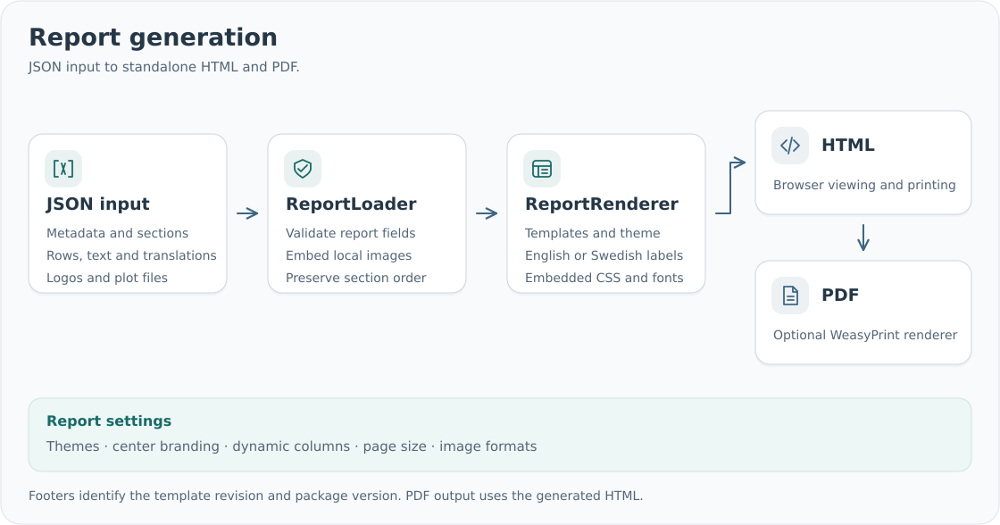

# smd-reports


[](https://smd-reports.readthedocs.io/en/latest/installation/)
[](https://github.com/SMD-Bioinformatics-Lund/smd-reports/blob/master/CHANGELOG.md)
[](https://github.com/SMD-Bioinformatics-Lund/smd-reports/actions/workflows/quality.yml)
[](https://smd-reports.readthedocs.io/en/latest/)
[](https://smd-reports.readthedocs.io/en/latest/rendering/)
[](https://github.com/SMD-Bioinformatics-Lund/smd-reports/blob/master/LICENSE)

Report template revisions:

[](https://smd-reports.readthedocs.io/en/latest/rendering/#template-and-package-versions)
[](https://smd-reports.readthedocs.io/en/latest/rendering/#template-and-package-versions)
[](https://smd-reports.readthedocs.io/en/latest/rendering/#template-and-package-versions)
[](https://smd-reports.readthedocs.io/en/latest/rendering/#template-and-package-versions)
[](https://smd-reports.readthedocs.io/en/latest/rendering/#template-and-package-versions)
[](https://smd-reports.readthedocs.io/en/latest/rendering/#template-and-package-versions)

Render JSON reports as standalone HTML and PDF with shared layouts, configurable branding
and Swedish/English labels. Select themes and layouts independently, or use a built-in preset.

See the [configuration reference](https://smd-reports.readthedocs.io/en/latest/configuration/)
for all supported settings and defaults.

Build reports from JSON. Define columns once and supply values as row lists. HTML includes its CSS,
print rules, fonts and artwork, so it can be converted elsewhere with WeasyPrint.
Use compact wrapping tables for gene and haplotype lists, or highlight selected result rows.
Choose preset/custom paper sizes, attach plots to sections, and format summaries,
descriptions and references as plain text or Markdown.

## Report workflow



The [development and release workflow](https://smd-reports.readthedocs.io/en/latest/contributing/#pull-requests)
and [documentation publishing workflow](https://smd-reports.readthedocs.io/en/latest/contributing/#documentation-hosting)
are described in the contribution guide.

## Install

Requires Python 3.10 or newer. Install with pip:

```sh
python -m pip install smd-reports
# Include the optional PDF renderer:
python -m pip install "smd-reports[pdf]"
```

The distribution name is `smd-reports`; the Python import name is `smd_reports`.
PDF rendering also requires native Pango libraries. See [installation](https://smd-reports.readthedocs.io/en/latest/installation/).

## Use from Python

```python
from pathlib import Path
from smd_reports import ReportLoader, ReportRenderer

report = ReportLoader().load("report.json")
renderer = ReportRenderer()
Path("report.html").write_text(renderer.render_html(report), encoding="utf-8")
# Requires the PDF extra:
Path("report.pdf").write_bytes(renderer.render_pdf(report))
```

Load JSON text with `ReportLoader().loads(json_text)` or files with `load(path)`.
The [Python guide](https://smd-reports.readthedocs.io/en/latest/python-api/) and [quickstart](https://smd-reports.readthedocs.io/en/latest/quickstart/) include examples.
Custom columns and detail fields are configured in JSON, including English/Swedish labels.

Group column labels by language and supply values in the same order:

```json
{
  "columns": {
    "en": ["Gene", "Copy number"],
    "sv": ["Gen", "Kopietal"]
  },
  "rows": [["EXAMPLE", 6]]
}
```

Optional `column_options` configures widths and formatting by column index.
Placeholders such as `<PATIENT_NAME>` remain visible in HTML and PDF output; see
[placeholder values and replacement](https://smd-reports.readthedocs.io/en/latest/json-inputs/#placeholders-for-later-replacement).

## Use from the command line

```sh
smd-reports validate report.json
smd-reports render report.json --format html --output report.html
smd-reports render report.json --format pdf --output report.pdf
smd-reports normalize report.json --output report.portable.json
smd-reports schema --output report.schema.json
```

The same commands are available with `python -m smd_reports`.

## Documentation

Read the [documentation](https://smd-reports.readthedocs.io/en/latest/) for installation, Python usage, JSON inputs and rendering.

- [Overview](https://smd-reports.readthedocs.io/en/latest/), [installation](https://smd-reports.readthedocs.io/en/latest/installation/) and [quickstart](https://smd-reports.readthedocs.io/en/latest/quickstart/)
- [Python usage](https://smd-reports.readthedocs.io/en/latest/python-api/) and [Python API reference](https://smd-reports.readthedocs.io/en/latest/reference/)
- [Report examples and presets](https://smd-reports.readthedocs.io/en/latest/integration/), [JSON format](https://smd-reports.readthedocs.io/en/latest/json-inputs/)
  and [Command-line reference](https://smd-reports.readthedocs.io/en/latest/cli/)
- [Center branding](https://smd-reports.readthedocs.io/en/latest/branding/) and [HTML/PDF rendering](https://smd-reports.readthedocs.io/en/latest/rendering/)
- [Contributing](https://smd-reports.readthedocs.io/en/latest/contributing/), [testing and releases](https://smd-reports.readthedocs.io/en/latest/validation/)
  and [changelog](https://github.com/SMD-Bioinformatics-Lund/smd-reports/blob/master/CHANGELOG.md)

The [GitHub wiki](https://github.com/SMD-Bioinformatics-Lund/smd-reports/wiki) mirrors the documentation.

Runnable synthetic examples and complete JSON inputs are in [examples/](https://github.com/SMD-Bioinformatics-Lund/smd-reports/tree/master/examples/).

## Example reports

| Preset | HTML | PDF | Input |
| --- | --- | --- | --- |
| Generic | [HTML](https://github.com/SMD-Bioinformatics-Lund/smd-reports/blob/master/examples/rendered/generic.html) | [PDF](https://github.com/SMD-Bioinformatics-Lund/smd-reports/blob/master/examples/rendered/generic.pdf) | [JSON](https://github.com/SMD-Bioinformatics-Lund/smd-reports/blob/master/examples/inputs/generic.json) |
| Custom presentation | [HTML](https://github.com/SMD-Bioinformatics-Lund/smd-reports/blob/master/examples/rendered/custom.html) | [PDF](https://github.com/SMD-Bioinformatics-Lund/smd-reports/blob/master/examples/rendered/custom.pdf) | [JSON](https://github.com/SMD-Bioinformatics-Lund/smd-reports/blob/master/examples/inputs/custom.json) |
| Coyote3 | [HTML](https://github.com/SMD-Bioinformatics-Lund/smd-reports/blob/master/examples/rendered/coyote3.html) | [PDF](https://github.com/SMD-Bioinformatics-Lund/smd-reports/blob/master/examples/rendered/coyote3.pdf) | [JSON](https://github.com/SMD-Bioinformatics-Lund/smd-reports/blob/master/examples/inputs/coyote3-dna.json) |
| Genexus | [HTML](https://github.com/SMD-Bioinformatics-Lund/smd-reports/blob/master/examples/rendered/genexus.html) | [PDF](https://github.com/SMD-Bioinformatics-Lund/smd-reports/blob/master/examples/rendered/genexus.pdf) | [JSON](https://github.com/SMD-Bioinformatics-Lund/smd-reports/blob/master/examples/inputs/genexus-en.json) |
| CLL Genie | [HTML](https://github.com/SMD-Bioinformatics-Lund/smd-reports/blob/master/examples/rendered/cll-genie.html) | [PDF](https://github.com/SMD-Bioinformatics-Lund/smd-reports/blob/master/examples/rendered/cll-genie.pdf) | [JSON](https://github.com/SMD-Bioinformatics-Lund/smd-reports/blob/master/examples/inputs/cll-genie-positive.json) |
| PGxModule | [HTML](https://github.com/SMD-Bioinformatics-Lund/smd-reports/blob/master/examples/rendered/pgx.html) | [PDF](https://github.com/SMD-Bioinformatics-Lund/smd-reports/blob/master/examples/rendered/pgx.pdf) | [JSON](https://github.com/SMD-Bioinformatics-Lund/smd-reports/blob/master/examples/inputs/pgx.json) |

These reports use synthetic clinical data and generic application, center and accreditation
placeholders. Production reports use the artwork supplied through JSON.
Download HTML files and open them locally; CSS, fonts and artwork are embedded. PDFs can
be previewed directly in GitHub.

## License

Copyright (C) 2026 Ram Nanduri.

[GPL-3.0-only](https://github.com/SMD-Bioinformatics-Lund/smd-reports/blob/master/LICENSE). Embedded Source Sans 3 fonts use the
[SIL Open Font License](https://github.com/SMD-Bioinformatics-Lund/smd-reports/blob/master/src/smd_reports/static/SourceSans3-LICENSE.md).
