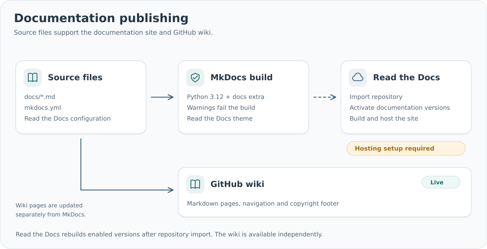
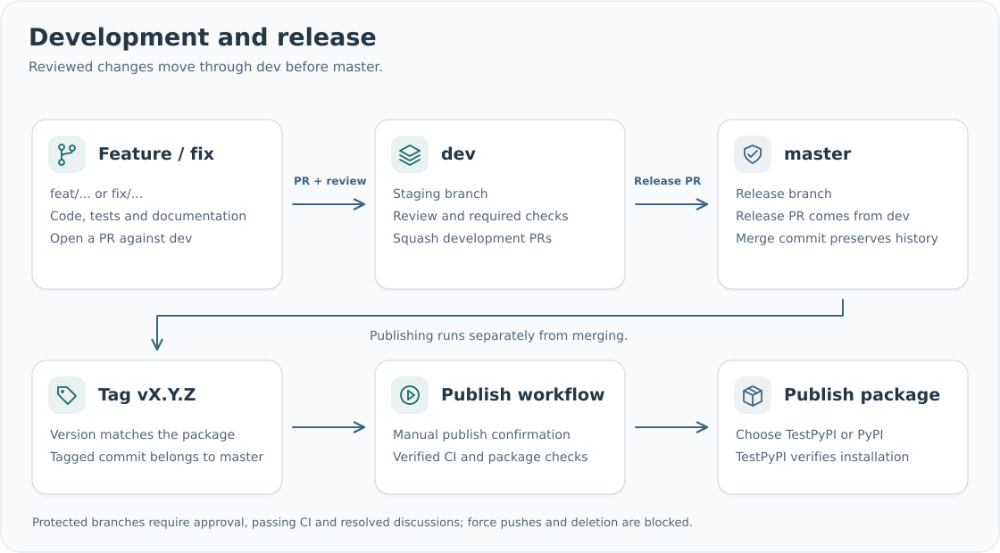

# Contributing

## Issues

Use the [issue forms](https://github.com/SMD-Bioinformatics-Lund/smd-reports/issues/new/choose)
for bugs, feature requests, documentation, usage questions and maintenance tasks.
Select the priority, affected components and report templates. Include the package version
and a minimal example for bugs. Report vulnerabilities through the private link described
in [the security policy](https://github.com/SMD-Bioinformatics-Lund/smd-reports/blob/master/SECURITY.md).

Issues receive type, priority, component and template labels from the form. Maintainers
confirm priority, assign an owner and select a milestone when scheduling work.
The `v0.1.0` milestone tracks the first public release.

| Priority | Use |
| --- | --- |
| `priority: critical` | P0: incorrect report content or a release-blocking failure |
| `priority: high` | P1: major functionality unavailable or significantly impaired |
| `priority: normal` | P2: standard fixes and planned improvements |
| `priority: low` | P3: minor improvements with a workaround |

New and reopened issues start with `status: triage`. Maintainers move accepted work to
`status: ready`, then `status: in progress` and `status: in review`. Use `status: blocked`
when work depends on another issue or decision. Adding a priority or status label removes
the previous label in that group. Closing
an issue removes its active status; GitHub's closed state records completion.

Form edits update the selected fields without resetting priority or component labels
changed by maintainers when those form fields have not changed. Custom labels are preserved.
Labels are defined in `.github/labels.json`. The Issue management workflow synchronizes them
when that file changes on `master`; it can also be run manually.

## Development setup

From a source checkout, create an environment and install the development tools:

```sh
python -m venv .venv
source .venv/bin/activate
python -m pip install -e '.[dev,test,docs,pdf]'
python -m pre_commit install
python -m pre_commit run --all-files
```

PDF tests require the native libraries listed in [installation](installation.md).
Pre-commit runs Ruff linting and formatting, checks JSON/YAML/TOML, and checks whitespace
and merge conflict markers. CI runs the same hooks. Ruff uses a 100-character line limit
and Google-style docstrings; EditorConfig supplies matching editor defaults.

Document public classes and functions with a concise description and relevant `Args`,
`Returns` and `Raises` sections. Keep package authorship and contact information in
`pyproject.toml`; source files need module docstrings rather than repeated metadata headers.

## Tests and documentation

```sh
python -m pytest -q --cov=smd_reports --cov-branch --cov-report=term-missing --cov-report=html
python -m mkdocs build --strict
```

The coverage minimum is 75%, including branches. Add tests for observable behavior and
failure cases; see [testing and releases](validation.md) for distribution checks.
Use `python -m mkdocs serve` to preview documentation locally.

## Documentation hosting

Documentation is hosted at [smd-reports.readthedocs.io/en/latest/](https://smd-reports.readthedocs.io/en/latest/).
The `.readthedocs.yaml` file configures builds using `mkdocs.yml`, Python 3.12 and the
package's `docs` extra. Documentation warnings fail the build, as they do in CI.



The Read the Docs GitHub integration rebuilds enabled versions when their source changes.
Use `master` for release documentation; additional branches and tags can be enabled in the
Read the Docs project settings. Keep the GitHub website field, README and package
Documentation URL pointed at the hosted site.

The [GitHub wiki](https://github.com/SMD-Bioinformatics-Lund/smd-reports/wiki) is also
maintained from the same source files.


## Documentation versions

Read the Docs builds each activated release tag from the documentation stored in that tag.
`latest` follows the configured default branch, which should be `master` for this project.
`stable` follows the highest stable release version. Individual tag URLs, such as
`https://smd-reports.readthedocs.io/en/v0.1.0/`, keep the corresponding release documentation.

In the Read the Docs project dashboard, add an Automation Rule with these settings:

| Setting | Value |
| --- | --- |
| Version type | Tag |
| Match | SemVer versions |
| Action | Activate version |
| Enabled | Yes |

The GitHub integration then activates and builds future release tags automatically.
Existing tags must be activated separately under **Versions** because new rules do not
apply retroactively. Activate `v0.1.0` to publish its individual version URL. See the
[Read the Docs automation guide](https://docs.readthedocs.com/platform/stable/guides/automation-rules.html).

MkDocs uses `READTHEDOCS_CANONICAL_URL` for hosted builds so each version receives its
configured canonical URL. Local builds fall back to the public `/en/latest/` URL.
The wiki generator accepts the same environment-based configuration.

## Wiki publishing

Edit documentation in `docs/` and navigation in `mkdocs.yml`. The **Publish wiki** workflow
synchronizes those pages after documentation changes merge into `master`. It can also be
run manually on `master`. Feature branches and pull requests check generated pages and links
without publishing them.

The wiki retains its existing page URLs, with a sidebar generated from MkDocs navigation
and a footer from the configured copyright. Relative page links point to the wiki; images
and repository files link to the source commit. Code examples remain unchanged. The workflow
preserves wiki commit history and skips commits when the generated content is unchanged.

Wiki pages are generated files. Make edits in `docs/`; direct edits to the wiki are replaced
by the next synchronization. The workflow uses GitHub's automatic token with `contents: write`
permission, so no additional publishing secret is required. The wiki must already contain
at least one page before its Git repository can be cloned.

To preview the generated Markdown, choose an empty output directory:

```sh
python scripts/build_wiki.py --output .artifacts/wiki-preview \
  --repository SMD-Bioinformatics-Lund/smd-reports --revision "$(git rev-parse HEAD)"
```

CI builds both MkDocs and the wiki output. Missing relative links or duplicate wiki page
names fail the documentation check.

## Example reports

JSON files in `examples/inputs/` are the source for the report examples. Regenerate the
five versioned HTML/PDF previews after changing report appearance:

```sh
python examples/reports.py --previews --pdf --output examples/rendered
```

Review the PDFs and keep their data and artwork synthetic. Other generated output belongs
under `.artifacts/`.

## Pull requests



Create feature or bugfix branches from `dev` and open development PRs against `dev`.
Include the behavior change and relevant test results. Development PRs use squash merges.
Release PRs go from `dev` to `master` and use merge commits to preserve branch ancestry.
Both branches require one approving review, resolved discussions and passing checks on an
up-to-date branch. The maintainer `ramsainanduri` may bypass the approving-review requirement
for solo maintenance. Required CI checks and the other protections still apply, including to
administrators. Force pushes and branch deletion are blocked. Required checks are `branch-flow`, `lint`, `docs`, `core (3.10)`, `core (3.12)`,
`core (3.14)` and `pdf`. Release PRs to `master` must originate from this repository's `dev`
branch. The PR templates in `.github/PULL_REQUEST_TEMPLATE/` describe the expected checks.

See [publishing setup](publishing.md) for release configuration and commands.
