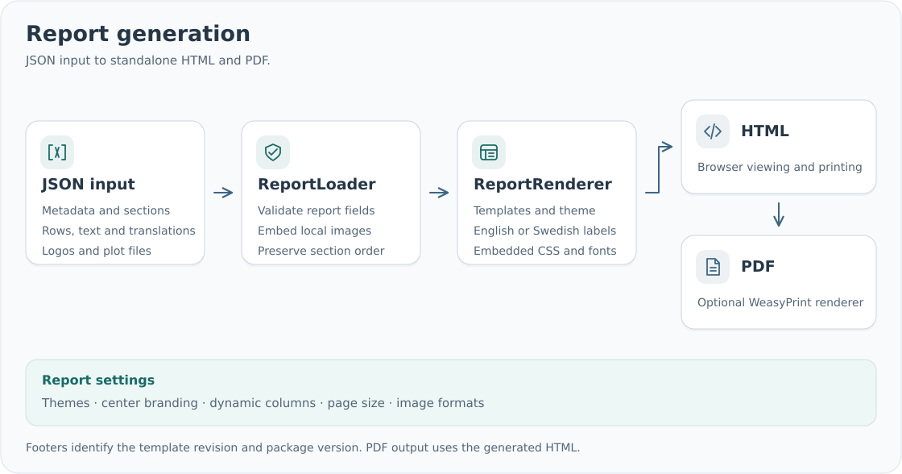

# smd-reports

Render validated JSON documents as standalone HTML and PDF from Python or the command line.
The package provides reusable report sections, configurable branding, English/Swedish labels
and print layouts with repeating headers, footers and page numbers.

Select a theme and layout independently, or use a built-in preset. Define columns once and supply
values as lists of rows. Add fields, translations, detail cards and plots through JSON.
HTML embeds styles, fonts and artwork for offline viewing and conversion.

Start with [installation](installation.md) and the [quickstart](quickstart.md).
The [JSON guide](json-inputs.md) describes the document format, [Python usage](python-api.md)
covers imports, and the [command-line reference](cli.md) lists available commands.
Browse the [examples](integration.md) for complete inputs and rendered reports.
