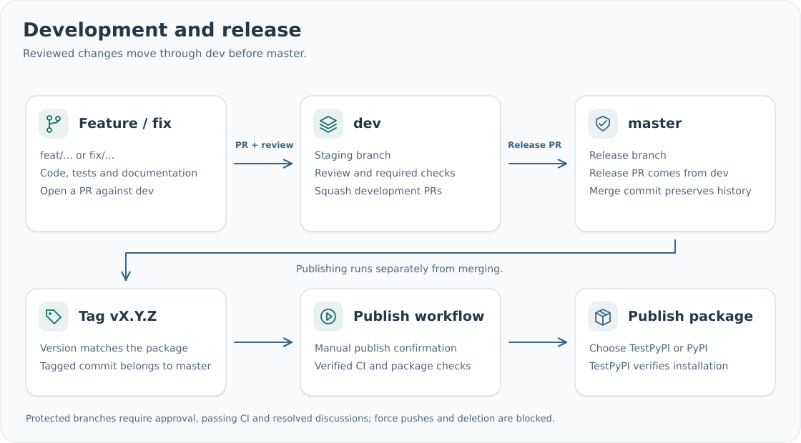

# Publishing setup

Publishing is manual. The `Publish package` workflow has no push, tag or release-event
trigger. It runs only after a maintainer starts it on `master` with an existing release
tag and the confirmation `publish`.

## One-time account configuration

Create an account on [PyPI](https://pypi.org/account/register/) and a separate account on
[TestPyPI](https://test.pypi.org/account/register/). Enable the account's required two-factor
authentication. For a new project, add a pending publisher on each service using its
account publishing settings. For an existing project, use its project publishing settings.

Enter these exact values for the GitHub Trusted Publisher:

| Setting | Value |
| --- | --- |
| Project name | `smd-reports` |
| Repository owner | `SMD-Bioinformatics-Lund` |
| Repository | `smd-reports` |
| Workflow filename | `release.yml` |
| Environment on PyPI | `pypi` |
| Environment on TestPyPI | `testpypi` |

The repository uses matching GitHub environments restricted to the `master` branch.
The workflow obtains short-lived publishing credentials through OIDC; no PyPI token
needs to be committed or stored in repository secrets. Account-side registration must
be completed by the account holder in PyPI and TestPyPI.

See the [official Trusted Publishing guide](https://docs.pypi.org/trusted-publishers/)
for account-side registration. If the GitHub repository is private, its documentation and
example links will remain private too; publishing a package does not change repository
visibility.

## Publish a release

After the development PR is merged into `dev` and the release PR is merged into `master`:

1. Confirm the version in `src/smd_reports/__init__.py` and the changelog.
2. Create the matching tag, for example `v0.1.0`, on the release commit in `master`.
3. Open GitHub Actions → **Publish package** → **Run workflow**.
4. Select branch `master`, enter the tag, choose `testpypi` and type `publish`.
5. Review the completed checks and TestPyPI installation verification.
6. Start the workflow separately with the same tag and index `pypi` when ready.

The workflow checks tag/version agreement, tag existence and `master` ancestry, then runs
tests, lint, documentation, distribution checks and isolated wheel/source installation.
Only the checked artifacts are passed to the publishing job. Package versions cannot be
overwritten; an existing version requires a new release rather than replacement files.
