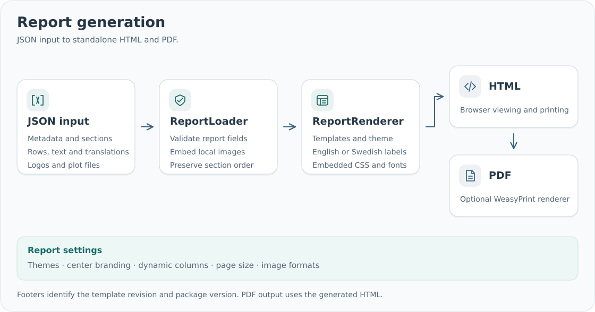

# HTML and PDF rendering

```python
from pathlib import Path
from smd_reports import ReportLoader, ReportRenderer

report = ReportLoader().load("report.json")
renderer = ReportRenderer()
Path("report.html").write_text(renderer.render_html(report), encoding="utf-8")
Path("report.pdf").write_bytes(renderer.render_pdf(report))
```



## Portable HTML

HTML embeds CSS, print rules, Source Sans 3 fonts and artwork. Plain text is escaped and
Markdown is sanitized. Reports require no JavaScript or external assets.

Convert the HTML on another machine with:

```sh
weasyprint --custom-metadata report.html report.pdf
```

That machine needs WeasyPrint and its native runtime, but not `smd-reports`, the source
JSON or the original image files. `--custom-metadata` retains the automatically filled
rendering metadata; PDF output from `ReportRenderer` includes it by default.

## Print layout

Reports default to A4 with repeating center branding and compact report metadata.
Ordinary tables repeat headers across pages and fit columns to their headings and content.
Explicit JSON width weights select proportional widths instead. Text wraps when needed. Compact tables wrap independent items across the available
width with shared cell borders and continue across pages. Cell text stays on one line. Finding cards and grouped grids use their JSON layout.

Sections with `kind: "summary"` use the yellow summary box and always have page
breaks before and after. Long summaries and full-width detail comments can span pages.
Set `page_break_before: true` on any other section for an additional break.

Use `presentation.header_height_mm` and `footer_height_mm` to adjust reserved print space.
Genexus repeats the report title in its header. The accreditation logo, when enabled,
appears opposite the template and package versions and page number.

## Page size

Choose a preset through `presentation.page_size`: A0–A6, B0–B6, Letter, Legal, Tabloid or
Executive. A4 is the default. `orientation` optionally selects `portrait` or `landscape`.

```json
{
  "presentation": {
    "page_size": "A3",
    "orientation": "landscape",
    "header_height_mm": 65,
    "footer_height_mm": 38
  }
}
```

For a custom size, supply both dimensions:

```json
{
  "presentation": {
    "page_size": "custom",
    "custom_width_mm": 320,
    "custom_height_mm": 200
  }
}
```

Without an explicit orientation, custom width and height are used exactly as supplied.
An explicit orientation orders the shorter/longer dimensions accordingly. Page dimensions
must leave room for headers, footers and content. Print rules and the HTML preview width
use the selected dimensions; PDF media boxes use the same size.

## Language

`language: "en"` selects English interface labels and `Page X of Y` numbering;
`language: "sv"` selects Swedish labels and `Sida X av Y`. Custom labels and text can
include both translations in JSON. See [translations](json-inputs.md#translations).

## Themes

| Theme key | Colors |
| --- | --- |
| `generic` (default) | Slate |
| `coyote3` | Purple/orange |
| `genexus` | Blue |
| `cll_genie` | Dark orange |
| `pgx` | Teal |

Set `theme` in JSON to select colors independently of the preset and layout. Precedence
is the renderer's `theme=` argument, then JSON `theme`, then the selected preset's theme.
The selected key is recorded in the HTML `smd-reports:theme` metadata.

Themes retain the existing heading colors, table tints and header rules. Wordmark typography
uses `wordmark_size_pt`, `wordmark_weight`, `wordmark_spacing_px` and
`wordmark_suffix_color`. Shared summary-box styling is independent of theme colors.

You can register a custom theme on a renderer:

```python
from smd_reports import ReportRenderer, Theme

renderer = ReportRenderer()
renderer.register_theme(
    Theme(
        name="center",
        heading="#176B68",
        accent="#278780",
        tint="#edf7f5",
        rule_end="#9dcac0",
    )
)
html = renderer.render_html(report, theme="center")
```

The package records its version and template revision automatically in HTML metadata. PDF appearance can
vary with fonts, WeasyPrint and native libraries; use the same rendering environment when
comparing outputs. See [installation](installation.md) for PDF dependencies.

## Template and package versions

Each report footer shows the template name, its revision and the installed package version,
for example `Coyote3 DNA · Template 0.4.1 · smd-reports 0.4.1`.
Swedish reports use `Mall` as the template label.

A template revision identifies the package release in which that template last changed.
Unchanged templates retain their previous revision. Coyote3 DNA and RNA revisions are
tracked separately. The package version identifies the installed Python distribution,
including rendering code and dependencies, so it may differ from a template revision.
Both values are supplied by the package and cannot be overridden in report JSON.

| Template | Revision |
| --- | --- |
| Generic | 0.4.1 |
| Coyote3 DNA | 0.4.1 |
| Coyote3 RNA | 0.4.1 |
| Genexus | 0.4.1 |
| CLL Genie | 0.4.1 |
| PGx | 0.4.1 |

Inspect `report.template_name`, `report.template_version` and `report.rendering_metadata`
from Python. A package release may update only the templates affected by its changes.
